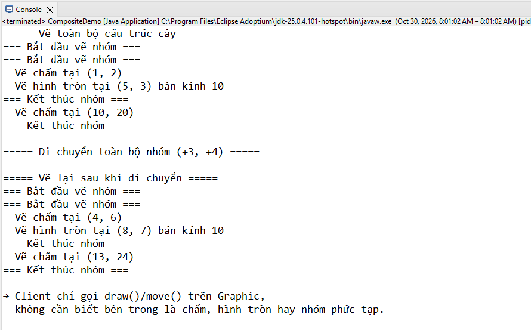
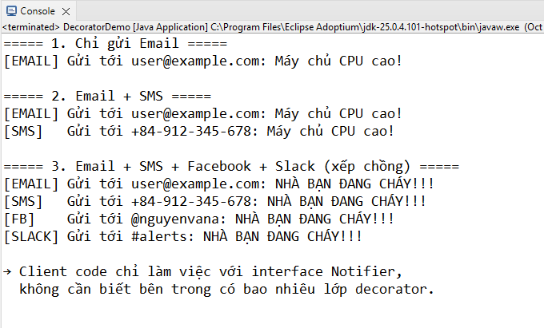

# Ví dụ Design Patterns: Decorator & Composite

Project Java đơn giản, chạy được ngay trong **Eclipse**.

## Cấu trúc

```
DesignPatternsExamples/
└── src/
    ├── decorator/          ← Mẫu Decorator (Notification)
    │   ├── Notifier.java
    │   ├── EmailNotifier.java
    │   ├── NotifierDecorator.java
    │   ├── SMSDecorator.java
    │   ├── FacebookDecorator.java
    │   ├── SlackDecorator.java
    │   └── DecoratorDemo.java      ← chạy class này
    │
    └── composite/          ← Mẫu Composite (Hình học)
        ├── Graphic.java
        ├── Dot.java
        ├── Circle.java
        ├── CompoundGraphic.java
        └── CompositeDemo.java      ← chạy class này
```

## Cách import vào Eclipse

## Cách chạy

- Mở `DecoratorDemo.java` → chuột phải → **Run As → Java Application**
- Mở `CompositeDemo.java` → chuột phải → **Run As → Java Application**

## Kết quả mong đợi

### DecoratorDemo



### CompositeDemo


## Giải thích ngắn

| Mẫu       | Ý tưởng chính                               | Trong ví dụ                      |
| --------- | ------------------------------------------- | -------------------------------- |
| Decorator | Bọc đối tượng để thêm hành vi lúc runtime   | SMS / Facebook / Slack bọc Email |
| Composite | Làm việc thống nhất với phần tử đơn và nhóm | Dot / Circle / CompoundGraphic   |
